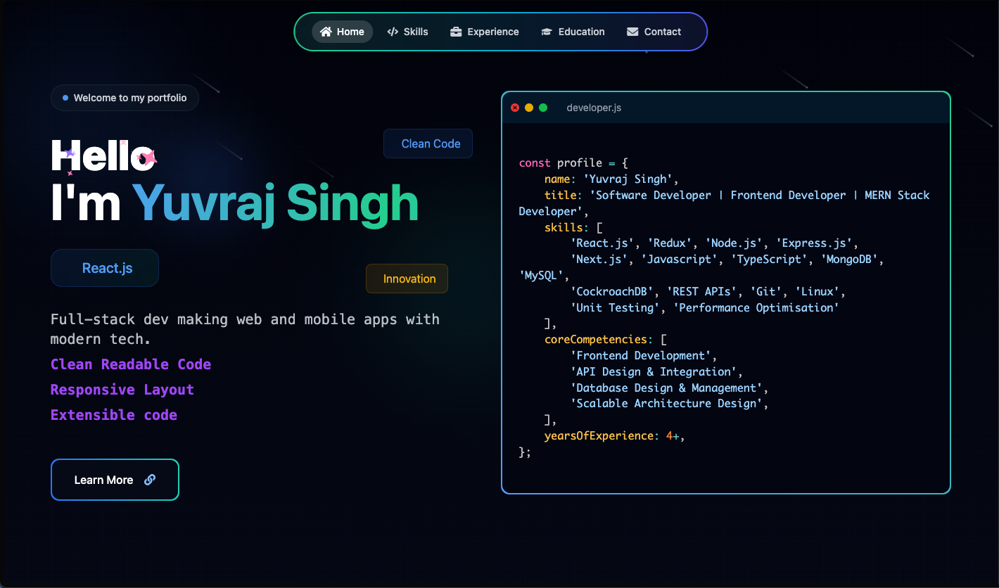
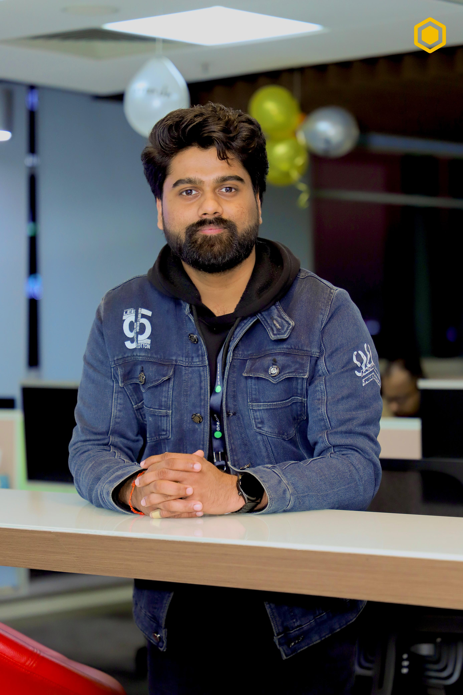

## Version 2

> 
>
> 🔗 [View on GitHub](https://github.com/MrToxicado/portfolio)
> 🔗 [v2 Portfolio](https://portfolio-portfolios-projects-691eb381.vercel.app/)

---

# Yuvraj Singh Portfolio

<div align="center">
  

  <h3>Software Developer | Frontend Developer | MERN Stack Developer</h3>

  <p>
    A personal portfolio website built with React, Vite, Tailwind CSS, Framer Motion, and modern UI components.
  </p>

  <p>
    <a href="https://github.com/MrToxicado/portfolio"><strong>Repository</strong></a>
    ·
    <a href="https://github.com/MrToxicado"><strong>GitHub Profile</strong></a>
    ·
    <a href="mailto:yuvrajsingh.ysk007@gmail.com"><strong>Email Me</strong></a>
  </p>
</div>

---

## About Me

Hey, I am **Yuvraj Singh**, a Software Engineer with 4+ years of experience developing and maintaining scalable SaaS applications, responsive web interfaces, and robust REST APIs.

Currently working as a **Software Developer** at **ANNEX LIFE**, with prior experience as a **Software Engineer** at **One.com**.

I work across full-stack development with technologies including React.js, TypeScript, JavaScript, Node.js, Express.js, Java, Spring Boot, PostgreSQL, MySQL, CockroachDB, Redis, Docker, Kubernetes, and AWS.

<div align="center">
  
</div>

---

## Portfolio Sections

- **Home:** Hero section with developer profile, core competencies, and interactive terminal.
- **About:** Introduction, background, experience summary, and interests.
- **Skills:** Frontend, backend, databases, cloud & DevOps, testing, and AI tooling.
- **Experience:** Professional journey at ANNEX LIFE and One.com with key metrics and achievements.
- **Education:** Academic background and achievements at GLA University.
- **Contact:** Email, location, and interactive contact form.

---

## Experience

| Role | Company | Period | Location |
| --- | --- | --- | --- |
| Software Developer | ANNEX LIFE | Mar 2026 - Present | Delhi, India |
| Software Engineer | One.com | Dec 2021 - Feb 2026 | Gurugram, India |

---

## Skills

- **Languages:** Java, JavaScript (ES6+), TypeScript, SQL, HTML5, CSS3
- **Backend:** Node.js, Express.js, Java, Spring Boot, Spring MVC, REST APIs, OOP, API Integration
- **Frontend:** React.js, Next.js, Redux, React Hooks, Angular, Tailwind CSS, Responsive Design
- **Databases & Caching:** PostgreSQL, MySQL, CockroachDB, Redis, Database Indexing, Query Optimization
- **Cloud & DevOps:** AWS (EC2, S3), Azure, Docker, Kubernetes, GitLab CI/CD, GitHub Actions, PM2, Linux
- **Testing & Quality:** Jest, React Testing Library, Unit & Integration Testing, SonarQube, Code Reviews
- **Tools & AI:** Git, GitHub, GitLab, Postman, VS Code, Vite, ChatGPT, Claude, GitHub Copilot

---

## Education

| Degree | Institute | Year |
| --- | --- | --- |
| B.Tech, Computer Science | GLA University, Mathura | 2018 - 2022 |
| Intermediate (+2) | St. Conrad's Inter College, Agra | 2017 - 2018 |
| High School | St. Conrad's Inter College, Agra | 2015 - 2016 |

---

## Contact

- **Email:** [yuvrajsingh.ysk007@gmail.com](mailto:yuvrajsingh.ysk007@gmail.com)
- **Location:** Noida, 201301
- **GitHub:** [MrToxicado](https://github.com/MrToxicado)
- **Repository:** [MrToxicado/portfolio](https://github.com/MrToxicado/portfolio)

---

## Tech Stack

- **Frontend:** React 18, Vite
- **Styling:** Tailwind CSS
- **Animations:** Framer Motion, Prism.js
- **Icons:** Lucide React, React Icons
- **Routing:** React Router, React Router Hash Link
- **Forms:** Web3Forms
- **Deployment:** Vercel-ready configuration

---

## Project Structure

```bash
portfolio/
├── public/
├── src/
│   ├── assets/
│   │   ├── css/
│   │   └── images/
│   │       ├── logo.svg
│   │       ├── profile.jpeg
│   │       └── profile2.jpeg
│   ├── components/
│   │   ├── Contact.jsx
│   │   ├── Education.jsx
│   │   ├── Experience.jsx
│   │   ├── Header.jsx
│   │   ├── Hero.jsx
│   │   ├── PortfolioPage.jsx
│   │   ├── Projects.jsx
│   │   ├── Skills.jsx
│   │   └── ui/
│   ├── constants/
│   │   └── index.js
│   ├── lib/
│   ├── App.jsx
│   └── main.jsx
├── index.html
├── package.json
├── tailwind.config.js
├── vercel.json
└── vite.config.js
```

---

## Getting Started

Clone the repository:

```bash
git clone https://github.com/MrToxicado/portfolio.git
cd portfolio
```

Install dependencies:

```bash
npm install
```

Run the development server:

```bash
npm run dev
```

Open the local app:

```bash
http://localhost:5173/
```

Build for production:

```bash
npm run build
```

Preview the production build:

```bash
npm run preview
```

---

## Available Scripts

| Command | Description |
| --- | --- |
| `npm run dev` | Start the Vite development server |
| `npm run build` | Create a production build |
| `npm run preview` | Preview the production build locally |
| `npm run lint` | Run ESLint |

---

## License

This project is licensed under the MIT License.

---

<div align="center">
  Made with care by <strong>Yuvraj Singh</strong>
</div>
